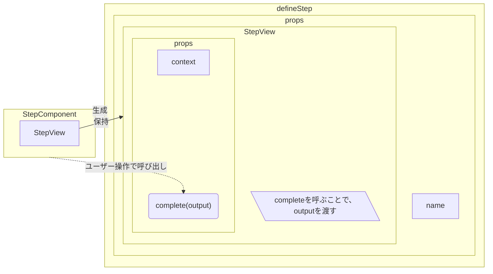

`defineStep`の際に定義される`complete`は、実際に呼ぶまで待たなければいけません。

そこで、`StepComponent`を生成しておいて、`StepComponent`の中で`complete`の具体的な処理を書く方法を試します。

---

利用者が`complete({ name: e.currentTarget.value })`のようにしたとき、`{ name }`が注入されながら実行されます。

しかし、利用者が用意した`StepView`には具体的な処理が書かれていません。

そこで、具体的な処理（`completeStep`）を持った親コンポーネントで包むことで、その子である`StepView`は`completeStep`を呼ぶことができます。

`complete`に`completeStep`を渡すと、ユーザーが`complete`を呼ぶことと`complete`引数で処理が降ることが両立します。

